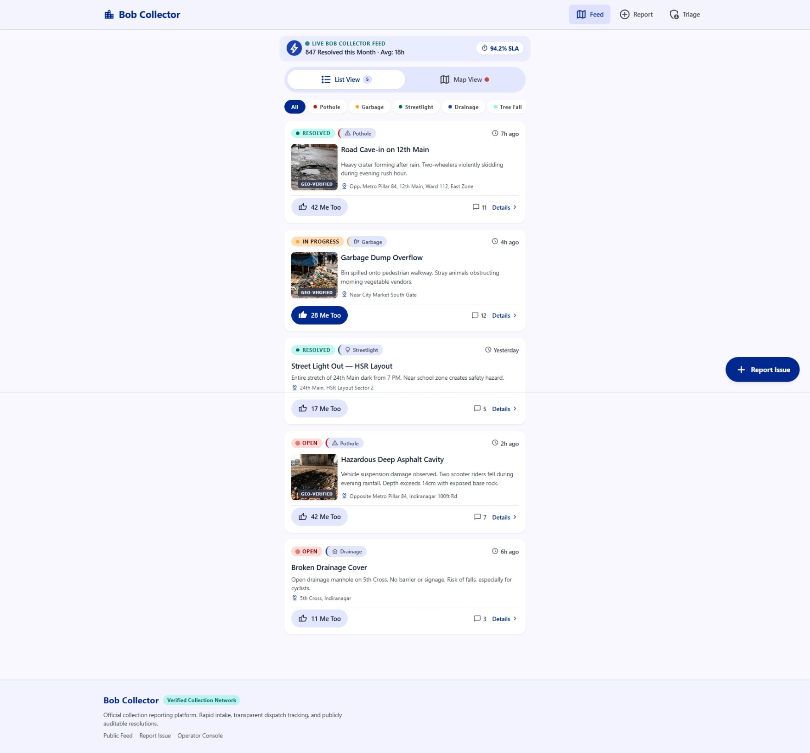
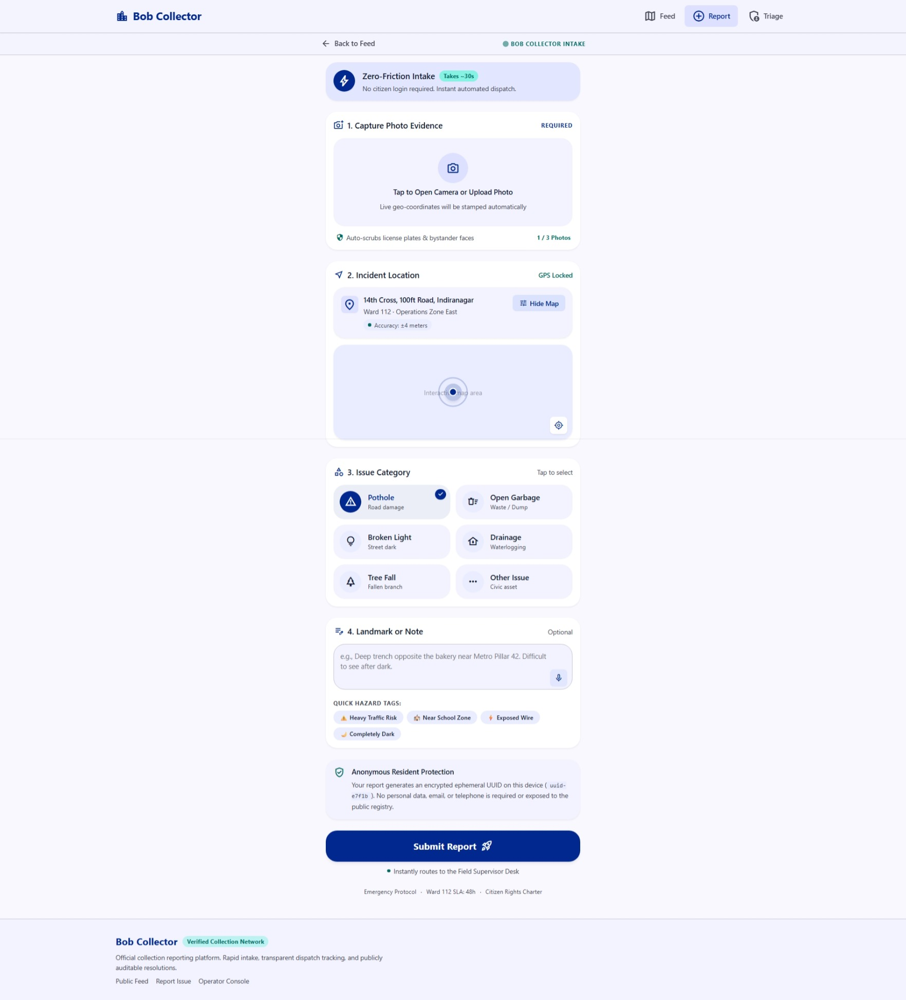
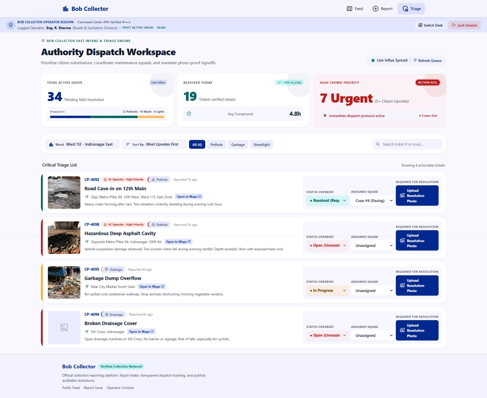

# Bob Collector

> **Civic issue reporting, resolved with proof.**

Bob Collector is a civic engagement platform where citizens snap a photo of a local problem — pothole, overflowing garbage, broken streetlight — and submit it with their GPS location in under 30 seconds. Reports land on a public feed where neighbours can upvote to signal urgency, automatically surfacing the highest-impact issues to a municipal authority triage dashboard. Authorities assign crews, track SLA deadlines with auto-escalation, and must upload a resolution photo to close a ticket — giving citizens visible, auditable proof that the problem was actually fixed.

---

## Screenshots

| Citizen Feed | Report Flow | Authority Triage |
|---|---|---|
|  |  |  |

---

## Repository Structure

```
bob-collector/
├── frontend/          # React 19 + Vite 8 + TypeScript citizen & authority UI
├── backend/           # Python 3.14 + FastAPI + uv REST API
├── docs/
│   ├── SYSTEM.md      # Functional requirements, DB schema & API contracts
│   ├── screens/       # Interactive HTML prototypes (5 screens)
│   └── screenshots/   # UI reference screenshots
├── DESIGN.md          # Design tokens, typography, color palette & component specs
└── AGENTS.md          # Agent coding guidelines
```

---

## Getting Started

### Prerequisites

| Tool | Version | Purpose |
|------|---------|---------|
| Node.js | ≥ 20 | Frontend dev server & build |
| uv | latest | Python environment & backend runner |
| Python | **3.14** | Backend runtime (managed by uv) |

> **Important:** Python 3.14 is required. Use `uv` — do not rely on a system Python install.

---

### Frontend

```bash
cd frontend
npm install
npm run dev        # Dev server at http://localhost:5173
```

Other commands:

```bash
npm run build      # Type-check + production build → dist/
npm run lint       # ESLint
npm run preview    # Preview the production build
```

---

### Backend

```bash
cd backend
uv sync            # Install dependencies into .venv
uv run backend     # Start FastAPI server (uvicorn)
```

The API is served at **`http://localhost:8000`** with base path `/api/v1`.

---

## Screens (HTML Prototypes)

Five fully interactive standalone prototypes are in [`docs/screens/`](docs/screens/). Open any `code.html` directly in a browser — no build step required.

| Screen | Path | Description |
|--------|------|-------------|
| Report Issue Flow | `docs/screens/report_issue_flow/` | Citizen photo capture, GPS lock, category selection |
| Public Issue Feed & Map | `docs/screens/public_issue_feed_map/` | Live feed with upvote (Me Too) and map view |
| Issue Detail & Proof | `docs/screens/issue_detail_proof/` | Before/After photo comparison, status timeline |
| Authority Triage Dashboard | `docs/screens/authority_triage_dashboard/` | Operator queue sorted by upvotes, SLA status |
| Civic Pulse | `docs/screens/civic_pulse/` | High-level civic metrics overview |

---

## API Overview

Base URL: `/api/v1`

| Method | Endpoint | Description |
|--------|----------|-------------|
| `POST` | `/upload` | Upload a photo, returns hosted URL |
| `GET` | `/issues` | List issues (filter by status, category, sort) |
| `POST` | `/issues` | Create a new issue report |
| `GET` | `/issues/:id` | Get a single issue with detail & proof |
| `POST` | `/issues/:id/upvote` | Upvote an issue (one per device) |
| `PATCH` | `/issues/:id/status` | Update status; RESOLVED requires proof photo |

Full request/response contracts are documented in [`docs/SYSTEM.md`](docs/SYSTEM.md).

---

## Tech Stack

### Frontend
- **React 19** + **React Router 7**
- **Vite 8** + **TypeScript ~6.0**
- Plain CSS with CSS custom properties (no Tailwind, no CSS-in-JS)
- ESLint 10 with `typescript-eslint`

### Backend
- **Python 3.14** + **FastAPI** + **uvicorn**
- **SQLite** — zero-config local database
- **uv** for environment and dependency management (`uv_build` build system)

### Prototypes
- Standalone HTML with **Tailwind CSS CDN** (config inlined per file)
- Material Design 3 color tokens, **Plus Jakarta Sans** + **Manrope** typography

---

## Team

Built entirely with **IBM Bob Agent**.

| Name | Role |
|------|------|
| Akash Mondal | Builder |
| Radhashyam | Builder |
